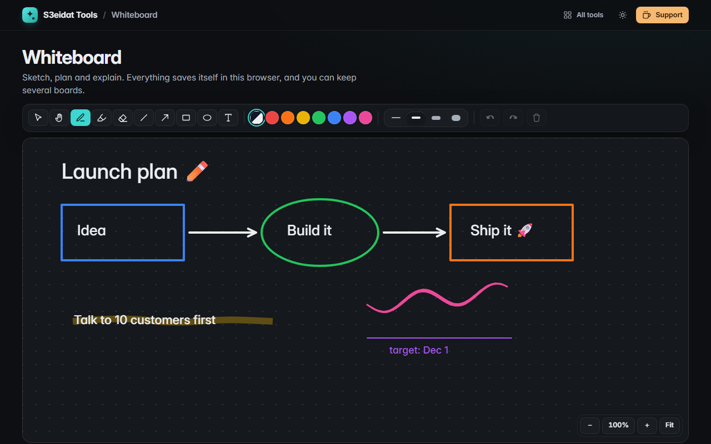

# Whiteboard

> A simple drawing board that saves itself. Free, private, and it runs entirely in your browser.

### ▶ [Open Whiteboard](https://s3eidat.github.io/whiteboard/)



## Features

- **Pen** with **pressure** on a stylus (Apple Pencil, Wacom, Surface pen), **highlighter**, and an **eraser** that removes whole strokes
- **Line, arrow, rectangle, ellipse** (hold <kbd>Shift</kbd> for 45° lines, squares and circles) and **text** (double-click text to edit it)
- 8 colours, including an "ink" colour that is black on a light board and white on a dark one; 4 widths
- **Select and move** any item, recolour or resize it, delete it with <kbd>Del</kbd>
- **Undo / redo** (<kbd>Ctrl</kbd>+<kbd>Z</kbd> / <kbd>Ctrl</kbd>+<kbd>Y</kbd>)
- **Pan and zoom**: hand tool, <kbd>Space</kbd>+drag, scroll, <kbd>Ctrl</kbd>+scroll or pinch to zoom, two fingers on touch screens, "Fit" to show everything
- **Light or dark board**, optional **dot grid**
- **Export PNG** (2× resolution) and **SVG** (real vector shapes and text)
- **Autosaves** in this browser, with **several boards** you can name, switch and delete; clearing asks first and can be undone
- Keyboard shortcuts: V select, H hand, P pen, M highlighter, E eraser, L line, A arrow, R rectangle, O ellipse, T text

## Privacy

Your drawings never leave your device. There is no server, no account, no analytics.
The page ships with a strict Content-Security-Policy (`connect-src 'self'`), so the browser
itself blocks any attempt to send data anywhere.

## Run it yourself

It's plain HTML, CSS and JavaScript with no build step:

```bash
git clone https://github.com/s3eidat/whiteboard
cd whiteboard
python -m http.server 8000
```

Then open http://localhost:8000.

## Support

If this saved you time, **[buy me a coffee ☕](https://s3eidat.github.io/coffee/)**. It keeps every tool free.

---

Part of **[S3eidat Tools](https://s3eidat.github.io/)**: 100+ free, private tools that run in your browser. MIT licensed.
